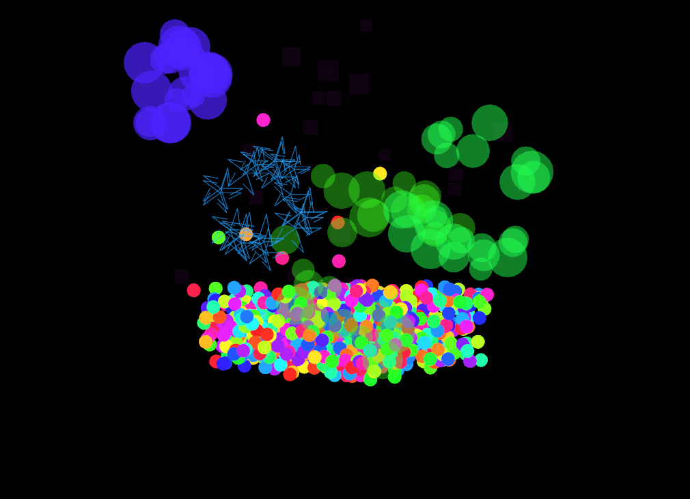
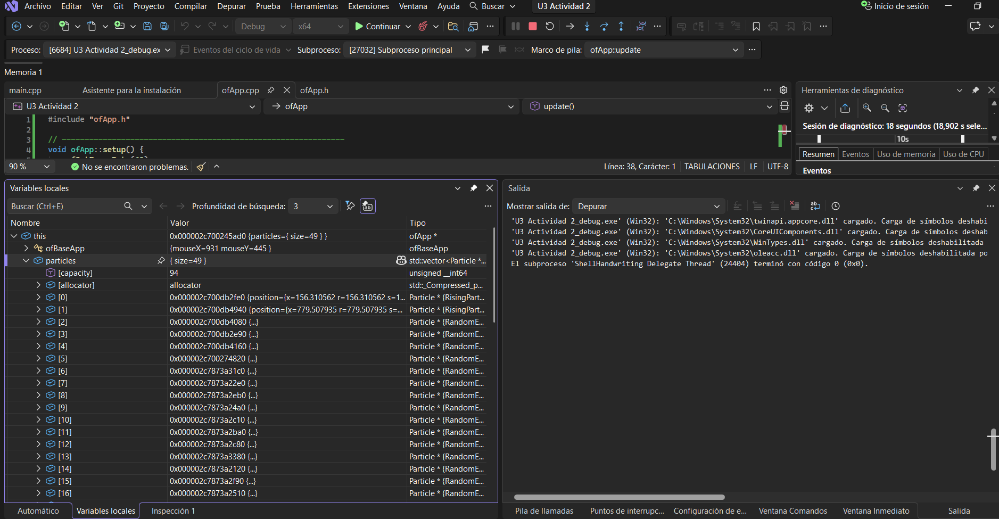
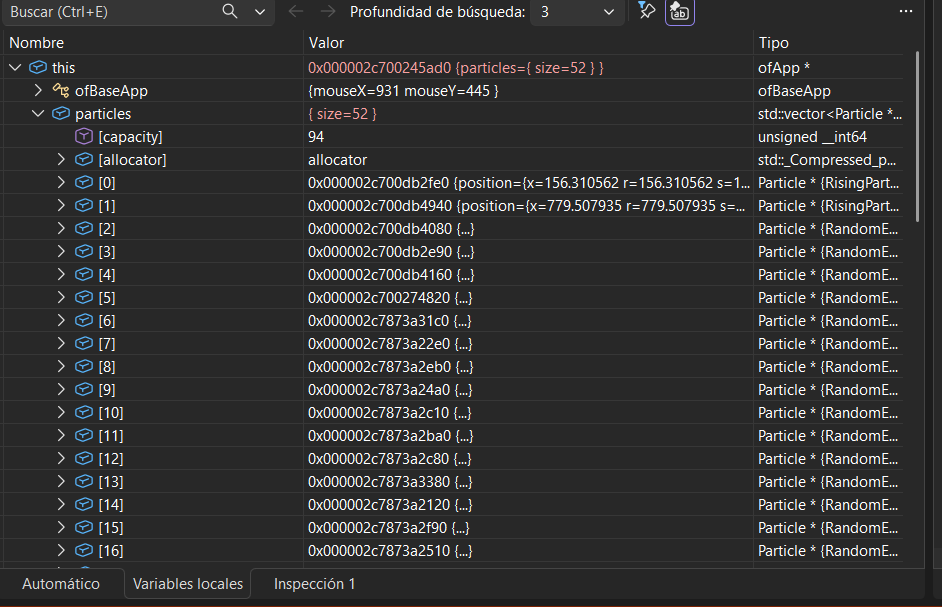
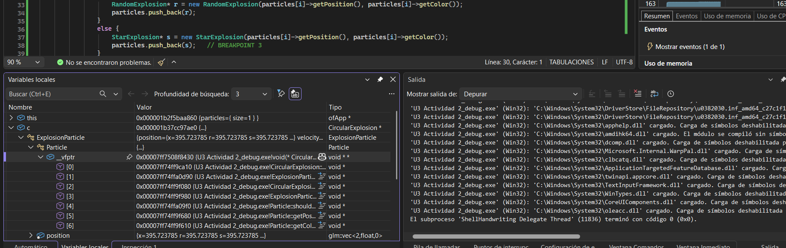
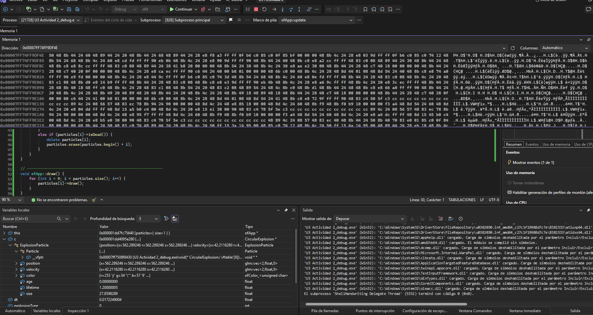
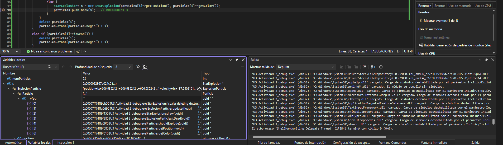

# Programación Orientada a Objetos

## Sesión 1: Investigación

### Actividad 1: diagnóstico inicial

#### Parte 1: recordando conceptos (C#)

1. ¿Qué es el encapsulamiento para ti?
- Es como "esconder" los datos de una clase pa que nadie de afuera los pueda tocar directamente, solo se pueda acceder por métodos o propiedades que yo defina. Me ha servido con una clase CuentaBancaria donde el saldo era private, así nadie le podía poner un valor negativo directo, solo a través de un método Depositar() que sí validaba.

2. ¿Qué es la herencia? ¿Por qué usarla?
- Es cuando una clase "hija" toma los atributos y métodos de una clase "padre", pa no repetir código. Ejemplo: una clase Animal con Comer(), y de ahí heredan Perro y Gato, que ya tienen Comer() gratis.

3. ¿Qué es el polimorfismo?
- Que un mismo método se comporte distinto dependiendo de qué objeto lo llame. Llamo Dibujar() y según si es Círculo o Rectángulo hace algo diferente, aunque yo lo llame "igual" desde afuera.

#### Parte 2: análisis de código (C#)

**Encapsulamiento:**
- La línea `private string nombre;` junto con `public string Nombre { get; protected set; }` es un ejemplo claro el campo está oculto y solo se accede por la propiedad.
- nombre es private y Nombre es public pa evitar que cualquiera desde afuera le cambie el valor sin control. El set es protected, así solo las clases hijas lo modifican, nadie más puede hacer figura.Nombre = "otra cosa" desde afuera. Esto evita que se dañe la consistencia del objeto.

**Herencia:**
- Se ve en `public class Circulo : Figura`.
- Además de Radio, un Circulo también tiene el campo Nombre (heredado de Figura), y el método Dibujar() sobreescrito.

**Polimorfismo:**
- Hipótesis: el programa guarda para cada objeto cuál es su tipo real (Circulo o Rectangulo), y al llamar fig.Dibujar() busca en tiempo de ejecución cuál versión usar, no en tiempo de compilación.

#### Parte 3: hipótesis sobre implementación

1. Memoria y herencia
- Yo creo que en memoria quedan los 3 datos uno detrás de otro en un mismo bloque: primero lo de Figura (Nombre), y después lo propio de Rectangulo (Base y Altura).

2. El mecanismo del polimorfismo
- Creo es que existe una "tabla" por cada tipo de objeto que le dice al programa qué función usar. Cuando se llama fig.Dibujar(), en tiempo de ejecución revisa esa tabla y llama la función correcta.

3. La barrera del encapsulamiento
- Yo pienso que eso se revisa en tiempo de compilación, porque si uno pone ac.privateVar = 30 el programa ni compila, marca error antes de correr. No es una protección que exista mientras corre, es una regla que chequea el compilador antes.

### Actividad 2: Aplicación (openFrameworks)

## 1. Partícula "base"

Existe una clase `Particle` que es como el molde genérico: dice que toda partícula debe poder actualizarse (`update`), dibujarse (`draw`) y saber si ya murió (`isDead`). De ahí se desprenden las dos familias de partículas:

- **`RisingParticle`** → el cohete que sube.
- **`ExplosionParticle`** → las chispitas que salen cuando el cohete explota, y de esta salen 3 sabores: `CircularExplosion`, `RandomExplosion` y `StarExplosion`.

Es básicamente herencia + polimorfismo

## 2. El cohete sube

Cuando uno hace clic (o le da espacio), se crea un `RisingParticle` que:

- Nace abajo, más o menos en el centro de la pantalla
- Le calculan hacia dónde tiene que ir (un puntico random arriba) y le meten velocidad en esa dirección
- Le ponen un color al azar (por eso salen de mil colores)
- Tiene un tiempo de vida random entre 1.5 y 3.5 segundos

Mientras sube, se le va aplicando como gravedad, entonces se va frenando poco a poco — simula que va perdiendo impulso. Cuando llega como al 15% de la altura de la pantalla (o se le acaba el tiempo), explota

## 3. La explosión

El programa:

1. Escoge al azar uno de los 3 tipos de explosión (circular, random o estrella)
2. Crea entre 20 y 30 partículas nuevas de ese tipo, todas naciendo justo donde explotó el cohete y con su mismo color
3. Borra el cohete original (con `delete`)

Cada tipo de explosión se mueve distinto:

- **Circular** → se reparten parejito en forma de círculo
- **Random** → cada una sale para donde le da la gana
- **Star (estrella)** → sale en direcciones tipo circular pero además se dibuja como una estrella de 5 picos usando trigonometría

Las chispitas de la explosión no tienen gravedad, solo van en línea recta y se van desvaneciendo (el alpha del color baja de 255 a 0 poquito a poquito) hasta que se mueren y se eliminan del vector.

La tecla `s` guarda un screenshot.

## Sesión 2

### Actividad 3: experimentos con el depurador

# **Actividad 3**

### Objeto ofApp en memoria

**Hipótesis (antes de ejecutar):**
Creo que voy a ver un bloque de memoria con lo que hereda de ofBaseApp y después el vector particles. Los métodos (setup, update, draw...) no creo que salgan ahí, porque el código es el mismo pa todos los objetos, no tiene sentido copiarlo en cada uno. El vector creo que no guarda las partículas adentro, sino punteros a ellas, porque es un vector de Particle*.

**¿Qué observo?**
- El objeto tiene primero la parte de ofBaseApp (con su propio __vfptr, porque ofBaseApp también tiene métodos virtuales)
- Después aparece particles, que es lo único que declaramos como dato en ofApp
- Los métodos no aparecen como datos del objeto
- Dentro de particles solo hay direcciones de memoria (punteros), las partículas de verdad están en otro lado

**¿Qué info me da el depurador?**
La dirección donde vive el objeto, el tipo de cada parte, los valores de cada campo y cuántos elementos tiene el vector (size).

**Conclusión:**
Un objeto en memoria son solo sus datos (atributos), puestos uno detrás de otro. Los métodos no viven dentro del objeto, viven una sola vez en el código del programa y todos los objetos los comparten.

### Objeto CircularExplosion en memoria

**Modificación que hice:** guardé cada explosión en una variable (c, r, s) antes del push_back pa poder pararme con un breakpoint y verla en Locals.

**¿Qué observo?**
El objeto está armado como capas, igual que la jerarquía:
- Particle → solo tiene el __vfptr (el puntero a la tabla)
- ExplosionParticle → position, velocity, color, age, lifetime, size
- CircularExplosion → no agrega datos nuevos, solo cambia el draw

En Memory 1 se ve todo seguido: primero 8 bytes del __vfptr, después los floats de position y velocity, después el color (4 bytes: r, g, b, a) y al final age, lifetime y size.

**Conclusión:**
Un objeto de una clase hija contiene adentro, en orden, las partes de todas sus clases padre. Por eso el primer campo de CircularExplosion es un ExplosionParticle y el primero de ese es un Particle.

### La _vtable de CircularExplosion

Es una tabla con 7 direcciones, una por cada método virtual:
- [0] destructor → de CircularExplosion
- [1] update → de ExplosionParticle
- [2] draw → de CircularExplosion
- [3] isDead → de ExplosionParticle
- [4] shouldExplode → de Particle
- [5] getPosition → de Particle
- [6] getColor → de Particle

Cada casilla dice de qué clase sale el método que se va a usar: si la clase lo sobreescribe usa el suyo, si no, usa el del papá o el abuelo.

### La _vtable de StarExplosion

Tiene las mismas 7 casillas en el mismo orden.

### Comparación
- **Lo que cambia:** el destructor [0] y el draw [2]. En una dice CircularExplosion::draw y en la otra StarExplosion::draw, porque cada una dibuja distinto (círculo vs estrella)
- **Lo que se repite:** update, isDead, shouldExplode, getPosition y getColor apuntan a la misma función en las dos, porque ninguna los sobreescribe, los heredan
- El orden de las casillas siempre es el mismo, lo que cambia es a dónde apunta cada una

**Conclusión:**
Cada clase con métodos virtuales tiene su propia tabla, y cada objeto guarda un puntero a la tabla de su clase. Los métodos virtuales son justamente los que aparecen en la tabla.

### ¿Para qué sirve la tabla?
Pa el polimorfismo. Cuando el programa hace particles[i]->update(dt) solo sabe que es un Particle*, no sabe si es circular, estrella o cohete. Entonces va al __vfptr del objeto, abre su tabla, busca la casilla de update y llama a la función que esté ahí. Como cada objeto trae su propia tabla, siempre se llama a la versión correcta sin necesidad de un if por cada tipo.

### Relación con C# (IAnimal)
Pasa lo mismo: animal es de tipo IAnimal, pero cada objeto (Perro o Gato) sabe cuál es su tipo real y trae su propia tabla de métodos. Cuando se llama animal.HacerSonido(), el programa busca en la tabla del objeto y llama al del Perro o al del Gato.
¿Cómo sabe sobre qué objeto actuar? Porque al llamar el método se le pasa escondido el objeto mismo (el this). Por eso la misma función sabe que tiene que trabajar con ese perro o ese gato y no con otro.
Los métodos virtuales son la herramienta, y el polimorfismo es el resultado: un mismo llamado que se comporta distinto según el objeto.

### Actividad 4: encapsulamiento

**Experimento 1 — descomentar protectedVar y privateVar:**
- No compila, error tipo "no se puede acceder a protectedVar/privateVar porque es protegido/privado en este contexto". protected solo permite acceso desde la clase o sus hijas, private solo desde la misma clase.

**Experimento 2 — obj.secret1 directo:**
- Error de compilación, mismo motivo: secret1 es private, no se puede acceder desde main() directo, solo por printMembers().

**Experimento 3 — reinterpret_cast pa saltarse el encapsulamiento:**
- Este sí compila y corre sin error, y sí logra mostrar los valores privados.
- Conclusión: el encapsulamiento en C++ es una protección que existe solo en tiempo de compilación. En memoria, un objeto privado no tiene ninguna protección física — los datos están ahí uno detrás de otro como cualquier dato. Con punteros y calculando bien las direcciones, se puede leer sin problema.

**¿Qué es el encapsulamiento y por qué es importante?**
- Para mi es una forma de decirle al compilador "esto es solo mío, nadie de afuera lo toca directo". Es importante porque evita errores — si cualquiera pudiera cambiar cualquier campo, sería fácil dejar un objeto en estado inválido (saldo negativo, radio negativo). Pero es una ayuda del compilador pa escribir código correcto, no una seguridad real a nivel de memoria.