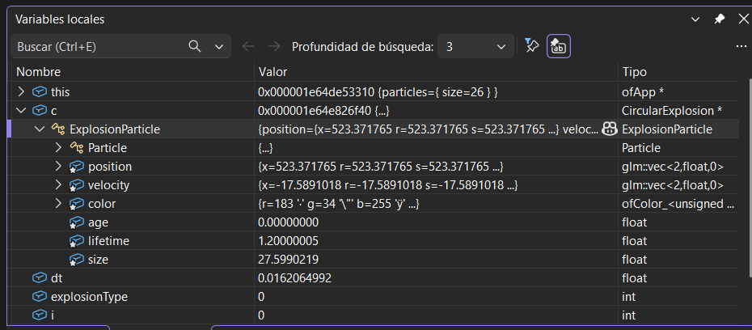
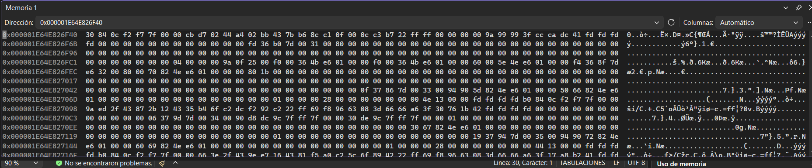
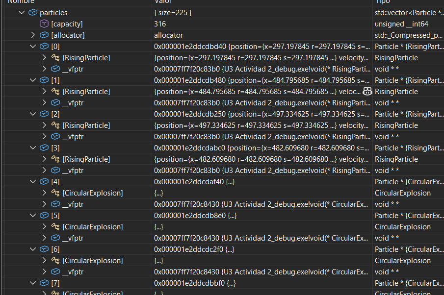
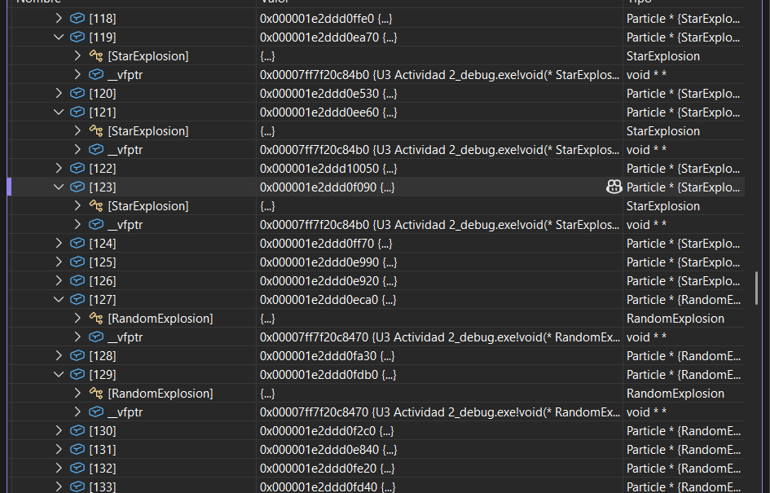
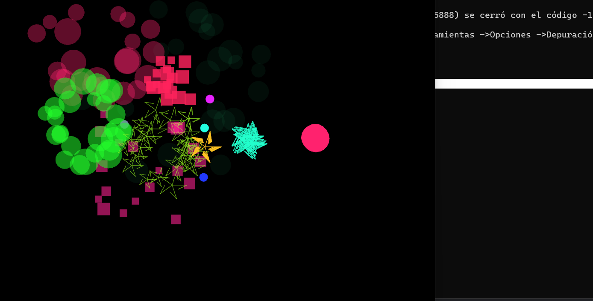
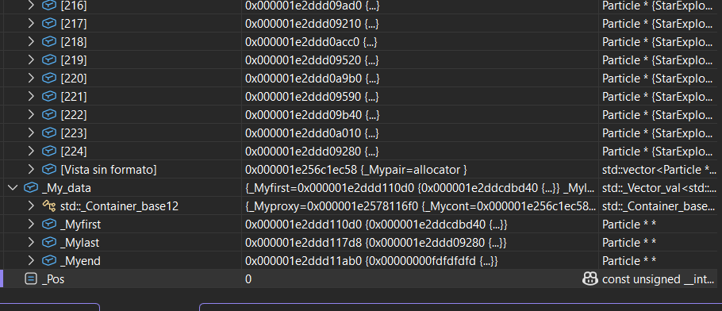
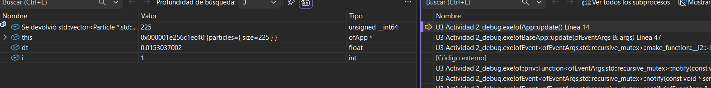
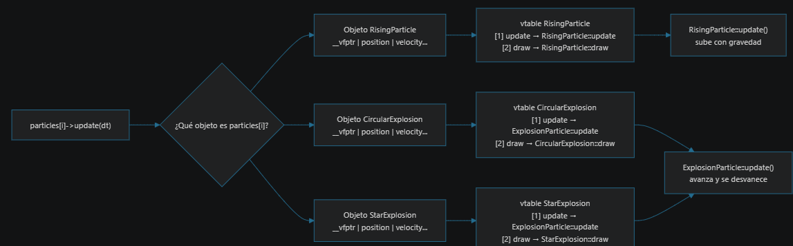
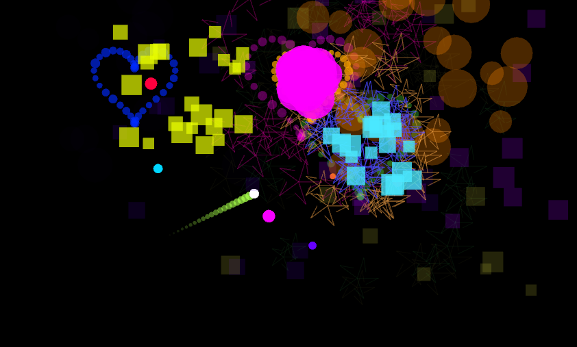

# **Actividad 5**

### Memoria de CircularExplosion vs jerarquía




### ¿Cómo se implementa la herencia en C++?
- Con `class Hija : public Padre`
- En memoria, la hija pone primero los datos del padre y después los suyos, uno detrás de otro
- Los métodos no se copian: la hija usa los del padre, y si los sobreescribe (override), la vtable apunta a la versión nueva
- El public en la herencia dice que lo que era public en el padre sigue siendo public en la hija


# **Actividad 6**

### Polimorfismo con el depurador






**¿Qué observo?**
- El vector particles es de Particle*, pero el depurador me muestra el tipo real de cada uno: unos son RisingParticle, otros CircularExplosion, otros StarExplosion
- La línea particles[i]->update(dt) es exactamente la misma pa todos, pero cuando entro con F11 a veces caigo en RisingParticle::update y a veces en ExplosionParticle::update
- Las 3 explosiones caen todas en ExplosionParticle::update porque ninguna lo sobreescribe, lo heredan. Donde sí se diferencian es en draw
- En el desensamblado la llamada no va a una dirección fija, sino que busca en [rax+8], o sea en la casilla 1 de la vtable del objeto

**¿Qué info me da el depurador?**
El tipo real de cada objeto (aunque el puntero sea de tipo Particle), en qué función entra en cada vuelta del for, y la pila de llamadas que confirma desde dónde se llamó.

### Dibujo: cómo funciona el polimorfismo en tiempo de ejecución



Paso a paso:
1. El programa llama update sobre un Particle*, no sabe qué tipo es
2. Va al objeto y lee su primer campo: el __vfptr
3. El __vfptr lo lleva a la vtable de la clase real del objeto
4. En la casilla de update encuentra la dirección de la función correcta
5. Llama esa función y le pasa el objeto (this)

**Conclusión:**
El polimorfismo en tiempo de ejecución no es magia: cada objeto carga un puntero a la tabla de su clase, y la llamada siempre hace el mismo camino (objeto → tabla → función). Lo que cambia es a qué tabla apunta cada objeto. Por eso con un solo for y una sola línea se actualizan cohetes y explosiones, cada uno a su manera, sin un solo if preguntando el tipo.

### Relación entre métodos virtuales y polimorfismo
- Los métodos virtuales son el mecanismo y el polimorfismo es el resultado
- Marcar un método como virtual le dice al compilador: "no decidas ahora cuál llamar, mételo en la vtable y decide cuando el programa esté corriendo"
- Sin virtual, el compilador decidiría por el tipo del puntero (Particle) y siempre llamaría a la misma función, sin importar qué objeto sea de verdad. O sea, no habría polimorfismo
- Por eso update, draw e isDead son virtual en Particle: pa que cada tipo de partícula pueda tener su propia versión y se llame la correcta


# **Actividad 7**

### Extensiones al caso de estudio

## Cambios en `ofApp.h`

```cpp
#include <deque>
#include <algorithm>
#include <cmath>
```

```cpp
class SpiralParticle : public Particle {
private:
    glm::vec2 center;
    float verticalSpeed, angle, angularSpeed, radius, age, lifetime;
    bool exploded;
    ofColor color;
    glm::vec2 currentPosition() const { return center + glm::vec2(cos(angle) * radius, 0); }
public:
    SpiralParticle(const glm::vec2& start, const ofColor& col, float life)
        : center(start), verticalSpeed(ofRandom(180, 260)), angle(0), angularSpeed(ofRandom(8, 12)),
          radius(0), age(0), lifetime(life), exploded(false), color(col) {}
    void update(float dt) override {
        center.y -= verticalSpeed * dt;
        angle += angularSpeed * dt;
        radius = std::min(radius + 40.0f * dt, 60.0f);
        age += dt;
        color.setHue(fmod(color.getHue() + 60.0f * dt, 255.0f));
        if (center.y <= ofGetHeight() * 0.25f || age >= lifetime) exploded = true;
    }
    void draw() override {
        ofSetColor(color);
        ofDrawCircle(currentPosition(), 7 + 3 * sin(angle));
    }
    bool isDead() const override { return exploded; }
    bool shouldExplode() const override { return exploded; }
    glm::vec2 getPosition() const override { return currentPosition(); }
    ofColor getColor() const override { return color; }
};

class CometParticle : public Particle {
private:
    glm::vec2 position, velocity, target;
    ofColor color;
    std::deque<glm::vec2> trail;
    static const int MAX_TRAIL = 20;
    float age, lifetime;
    bool exploded;
public:
    CometParticle(const glm::vec2& pos, const glm::vec2& tgt, const ofColor& col, float speed)
        : position(pos), target(tgt), color(col), age(0), lifetime(4.0f), exploded(false) {
        glm::vec2 dir = target - position;
        velocity = (glm::length(dir) < 1.0f) ? glm::vec2(0, -speed) : glm::normalize(dir) * speed;
    }
    void update(float dt) override {
        trail.push_front(position);
        if ((int)trail.size() > MAX_TRAIL) trail.pop_back();
        position += velocity * dt;
        age += dt;
        if (glm::dot(target - position, velocity) <= 0 || age >= lifetime) exploded = true;
    }
    void draw() override {
        for (int i = 0; i < (int)trail.size(); i++) {
            ofSetColor(color, ofMap(i, 0, MAX_TRAIL, 200, 0, true));
            ofDrawCircle(trail[i], ofMap(i, 0, MAX_TRAIL, 6, 1, true));
        }
        ofSetColor(255);
        ofDrawCircle(position, 7);
    }
    bool isDead() const override { return exploded; }
    bool shouldExplode() const override { return exploded; }
    glm::vec2 getPosition() const override { return position; }
    ofColor getColor() const override { return color; }
};
```

```cpp
class HeartExplosion : public ExplosionParticle {
public:
    HeartExplosion(const glm::vec2& pos, const ofColor& col, float t)
        : ExplosionParticle(pos, glm::vec2(0, 0), col, 1.8f, ofRandom(4, 7)) {
        float x = 16 * pow(sin(t), 3);
        float y = 13 * cos(t) - 5 * cos(2 * t) - 2 * cos(3 * t) - cos(4 * t);
        velocity = glm::vec2(x, -y) * 9.0f;
    }
    void update(float dt) override {
        ExplosionParticle::update(dt);
        velocity *= (1.0f - 1.5f * dt);
    }
    void draw() override {
        ofSetColor(color);
        ofDrawCircle(position, size);
    }
};
```

```cpp
void createSpiralParticle();
void createCometParticle(const glm::vec2& target);
void createExplosion(const glm::vec2& pos, const ofColor& col);
```

## Cambios en `ofApp.cpp`

```cpp
createExplosion(particles[i]->getPosition(), particles[i]->getColor());
```

```cpp
void ofApp::createExplosion(const glm::vec2& pos, const ofColor& col) {
    int explosionType = (int)ofRandom(4); // ahora 4 tipos
    if (explosionType == 3) {
        int n = 40;
        for (int j = 0; j < n; j++) {
            float t = ofMap(j, 0, n, 0, TWO_PI);
            particles.push_back(new HeartExplosion(pos, col, t));
        }
        return;
    }
    int numParticles = (int)ofRandom(20, 30);
    for (int j = 0; j < numParticles; j++) {
        if (explosionType == 0) particles.push_back(new CircularExplosion(pos, col));
        else if (explosionType == 1) particles.push_back(new RandomExplosion(pos, col));
        else particles.push_back(new StarExplosion(pos, col));
    }
}

void ofApp::createSpiralParticle() {
    glm::vec2 start(ofRandom(ofGetWidth() * 0.3, ofGetWidth() * 0.7), ofGetHeight());
    ofColor col;
    col.setHsb(ofRandom(255), 200, 255);
    particles.push_back(new SpiralParticle(start, col, ofRandom(2.5, 4.0)));
}

void ofApp::createCometParticle(const glm::vec2& target) {
    float x = (ofRandom(1) < 0.5) ? 0 : ofGetWidth();
    float y = ofRandom(ofGetHeight() * 0.5, ofGetHeight());
    ofColor col;
    col.setHsb(ofRandom(255), 180, 255);
    particles.push_back(new CometParticle(glm::vec2(x, y), target, col, ofRandom(400, 550)));
}
```

```cpp
if (button == OF_MOUSE_BUTTON_RIGHT) createSpiralParticle();
else createRisingParticle();
```

```cpp
if (key == 'c') {
    createCometParticle(glm::vec2(ofGetMouseX(), ofGetMouseY()));
}
```


**1. ¿Cómo y por qué de cada extensión?**

**SpiralParticle (clic derecho)**
- Hereda directo de Particle, no de RisingParticle, porque se mueve totalmente distinto
- Tiene un eje (center) que sube en línea recta y la posición real es el eje + cos(angle) * radius, o sea que va de lado a lado mientras sube
- El radio crece al subir y el tamaño cambia con sin(angle) pa que parezca que va adelante y atrás, como una espiral de frente
- Va cambiando de color mientras sube y explota al 25% de la altura

**CometParticle (tecla c)**
- También hereda directo de Particle
- Sale de un borde lateral y va en línea recta hacia donde está el mouse
- Guarda sus últimas 20 posiciones en un deque y las dibuja cada vez más chiquitas y transparentes, eso es la estela
- Explota cuando llega al objetivo. Pa saber si llegó uso el producto punto: si el vector hacia el objetivo ya apunta en contra de la velocidad, es que ya lo pasó

**HeartExplosion (nuevo modo de explosión)**
- Hereda de ExplosionParticle, igual que las otras explosiones
- Cada partícula recibe un t de 0 a 2π y sale con la velocidad de la curva del corazón (x = 16sin³t, y = 13cos t - 5cos 2t - 2cos 3t - cos 4t). La y va negativa porque en pantalla crece hacia abajo
- Como todas salen del mismo punto, juntas dibujan un corazón que se agranda
- Saqué la creación de explosiones a un método createExplosion() y ahora escoge al azar entre 4 tipos en vez de 3

**2. Encapsulamiento, herencia y polimorfismo en mi código**

**Encapsulamiento**
- En SpiralParticle y CometParticle todo el estado es private (ángulo, radio, estela...). Desde afuera nadie puede dañar el movimiento, solo se usa lo público: update, draw, getPosition
- currentPosition() es private porque es un detalle interno que a ofApp no le importa
- ExplosionParticle sí usa protected porque las hijas necesitan tocar velocity y position
- createExplosion, createSpiralParticle y createCometParticle son private en ofApp, solo los usa la misma clase

**Herencia**
- Las 2 partículas nuevas heredan de Particle y cumplen su contrato: tienen que implementar update, draw e isDead porque son virtuales puras
- HeartExplosion hereda de ExplosionParticle y no copia el update del padre, lo reutiliza con ExplosionParticle::update(dt) (mover + desvanecer) y solo le agrega el freno pa que el corazón no pierda la forma

**Polimorfismo**
- No toqué el for de particles[i]->update(dt) ni el de draw, y aun así funcionan con los tipos nuevos
- ofApp no sabe qué hay en cada posición del vector, solo sabe que es un Particle*. La vtable de cada objeto decide qué update y qué draw se llama
- Lo mismo con shouldExplode, getPosition y getColor: cada clase da su versión y createExplosion funciona igual venga de un Rising, un Spiral o un Comet

**3. ¿Cómo verifiqué que funciona?**

### Prueba visual


- Revisé que salieran los 4 tipos de explosión, incluido el corazón
- Revisé que las partículas desaparecen después de explotar, o sea que el delete se está haciendo


