# **Actividad 1**

# **Orientación y primer vistazo al entorno gráfico**

Captura de pantalla del ejemplo funcionando en máquina.
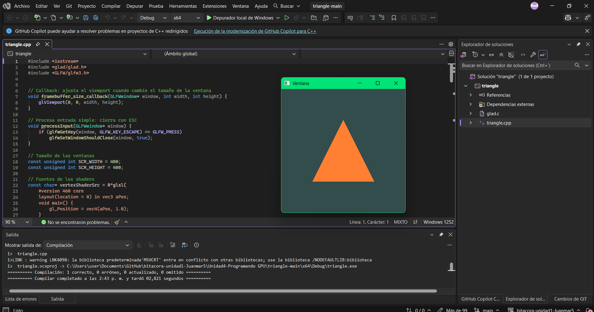

Preguntas al ver el código? Tres preguntas que te gustaría investigar más adelante (no te preocupes que la idea de esta unidad es que las resuelvas).
- Cómo se dibuja esto dentro de la GPU?
- Cómo se redirecciona de la CPU a la GPU?
- Cómo es que se calculan los pixeles y posiciones?

# **Actividad 2**

# **¿Cómo se crea un proyecto OpenGL en Windows?**

Toca crear proyecto vacío en C++ en Visual Studio y agregarle el triangle.cpp de la actividad 1 (o su codigo ps) para que se ejecute y muestre el triángulo
Crear una carpeta external con las dependencias: GLFW, GLAD (OpenGL 4.6, perfil Core) y GLM.
En las propiedades del proyecto, indicar dónde están los archivos de cabecera y la .lib de GLFW, y agregar glfw3.lib y opengl32.lib como librerías a enlazar.
Agregar glad.c al proyecto y copiar glfw3.dll junto al ejecutable.

**¿Qué necesita un programa OpenGL para funcionar en Windows?**

GLFW abre la ventana donde se dibuja y usa dos archivos: el .lib que sirve al compilar y el .dll, que tiene el código real
opengl32.lib viene con Windows y permite arrancar OpenGL.
GLAD al arrancar, va a los drivers, busca funciones y las alista para el código
GLM dibuja con matemáticas

La vaina funcionando con mi código
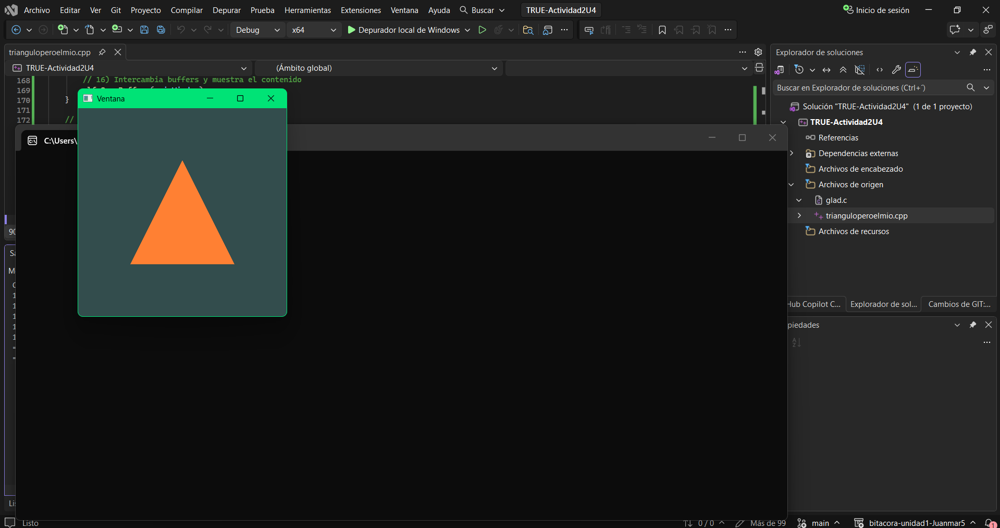

# **Actividad 03**

# **Análisis del ejemplo del triángulo simple parte 1**

**Experimento viewport**

Con glViewport(0, 0, bufferWidth, bufferHeight) el triángulo ocupa toda la ventana normal
Con glViewport(0, bufferHeight/2, bufferWidth/2, bufferHeight/2) el triángulo queda chiquito arriba a la izquierda, porque OpenGL cuenta desde abajo a la izquierda y le dije que arrancara a media altura
Dividiendo por 2 o 4 el triángulo se encoge y se va pa la esquina de abajo
Multiplicando por 2 o 4 el triángulo se agranda y se sale de la ventana, solo se ve un pedazo
Conclusión: el viewport es el pedazo de la hoja donde se dibuja, el triángulo se ajusta a ese pedazo
Si cambio el tamaño de la ventana el callback vuelve a poner el viewport completo

**Digestión**

GLFW crea la ventana y el contexto, el contexto es el taller donde OpenGL guarda todo
La GPU pinta en el framebuffer y el viewport dice en qué parte
GLAD carga las funciones, los shaders le dicen a la GPU cómo pintar
El game loop se repite: eventos, limpiar, dibujar, mostrar
¿Qué pasaría si cambio glClearColor? cambia el color de fondo (captura)

**Primitivas**

GL_LINES: sale una sola línea, porque usa los puntos de a dos y el tercero sobra
GL_POINTS: salen 3 puntitos muy pequeños en las esquinas del triángulo
Con 2 en vez de 3: no sale nada, un triángulo necesita 3 puntos
Con 4: sale el mismo triángulo (o algo raro), porque solo hay 3 puntos guardados y el cuarto no existe

**Preguntas**

1. Contexto OpenGL: el espacio de trabajo donde OpenGL guarda todo (colores, shaders, buffers) y lo conecta con la ventana
2. GLFW crea la ventana, el contexto y maneja teclado y mouse.
3. Porque el artista (OpenGL/GPU) necesita un taller con sus herramientas pa poder trabajar, sin taller no hace nada
4. El framebuffer es la hoja de píxeles donde se pinta cada cuadro antes de mostrarlo. Como el lienzo/canvas de píxeles de unidades anteriores
5. El viewport es la parte del framebuffer donde se dibuja, normalmente es todo el framebuffer
6. Los drivers tienen las funciones modernas de OpenGL y traducen las órdenes. La GPU es la que realmente pinta los píxeles
7. VSync sincroniza los cuadros con el monitor pa que no se vea la imagen cortada (tearing). Si la imagen es quieta no se nota nada pero la GPU trabaja de más sin necesidad. Si se mueve se ve cortada o temblorosa
8. OpenGL Legacy es el viejo, se dibujaba con glBegin/glEnd y punto por punto. El moderno usa shaders y manda los datos de una a la GPU, es más rápido y flexible
9. El shader program son los programitas que corren en la GPU y le dicen cómo ubicar los puntos y de qué color pintar. En el moderno sin shaders no se dibuja nada
10. setupTriangle guarda los 3 puntos del triángulo en la GPU. El VBO es la cajita con los datos y el VAO es la instrucción de cómo leer esa cajita
11. No es necesario si solo hay un shader y un VAO, porque el contexto se acuerda. Sirve hacerlo en cada loop cuando hay varios objetos con diferentes shaders o VAOs y hay que cambiar entre ellos
12. glfwSwapBuffers cambia la hoja donde se pintó por la que se ve en pantalla. Si no lo llamo la ventana se queda en negro o congelada, porque todo se dibuja en la hoja de atrás y nunca se muestra (captura)

Evidencias
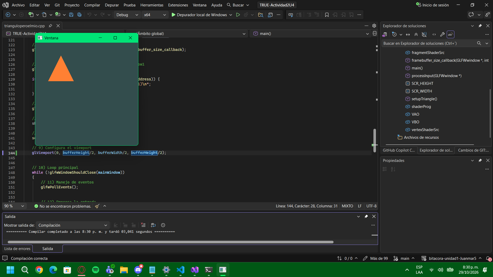
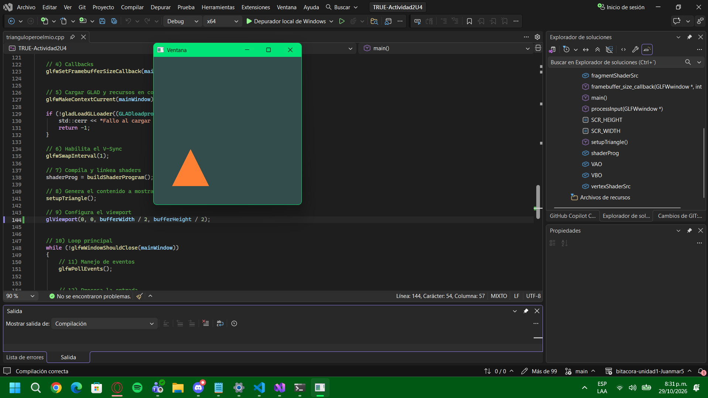
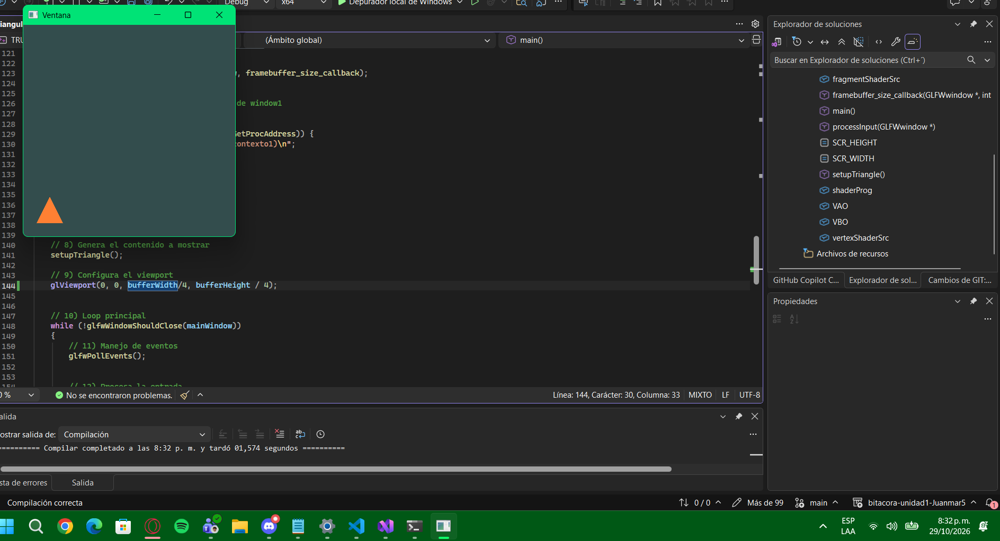
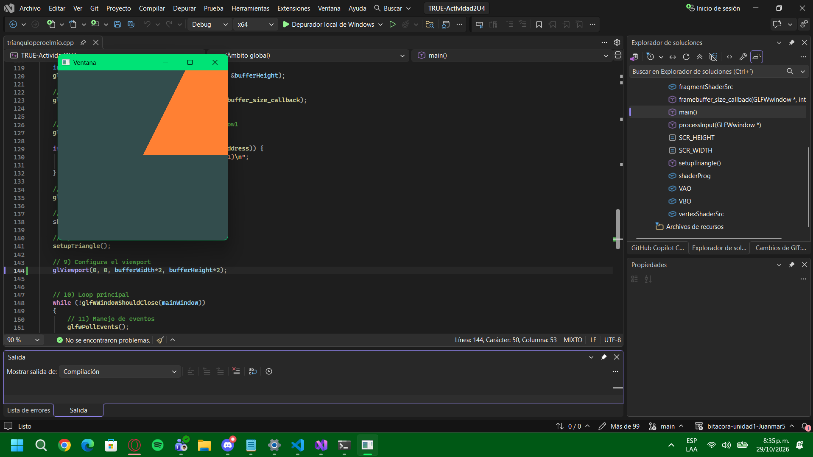
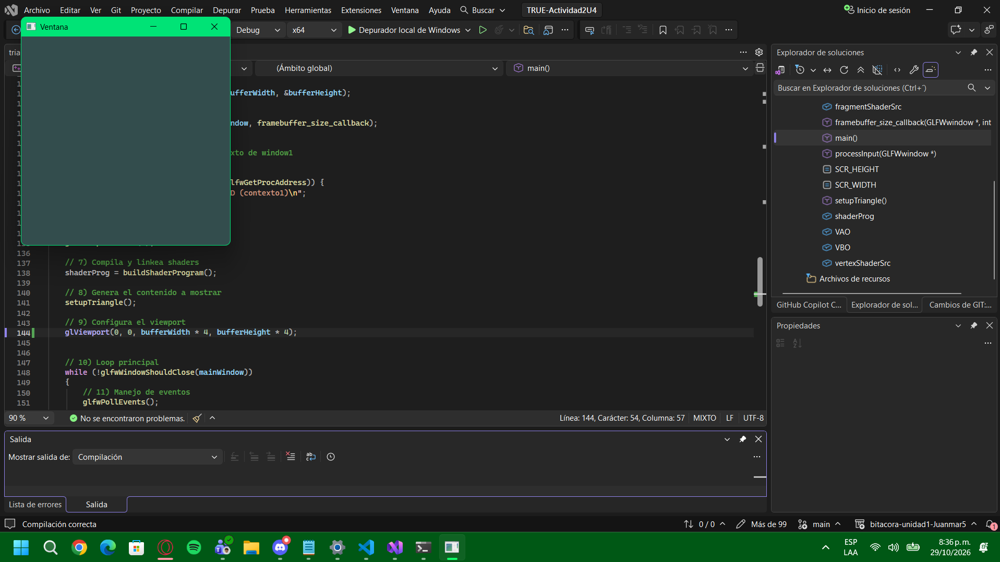
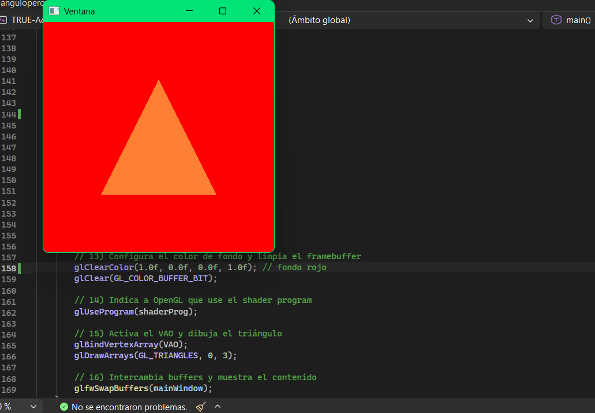
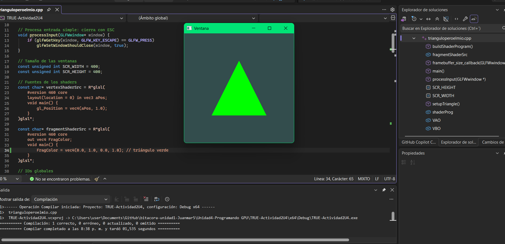
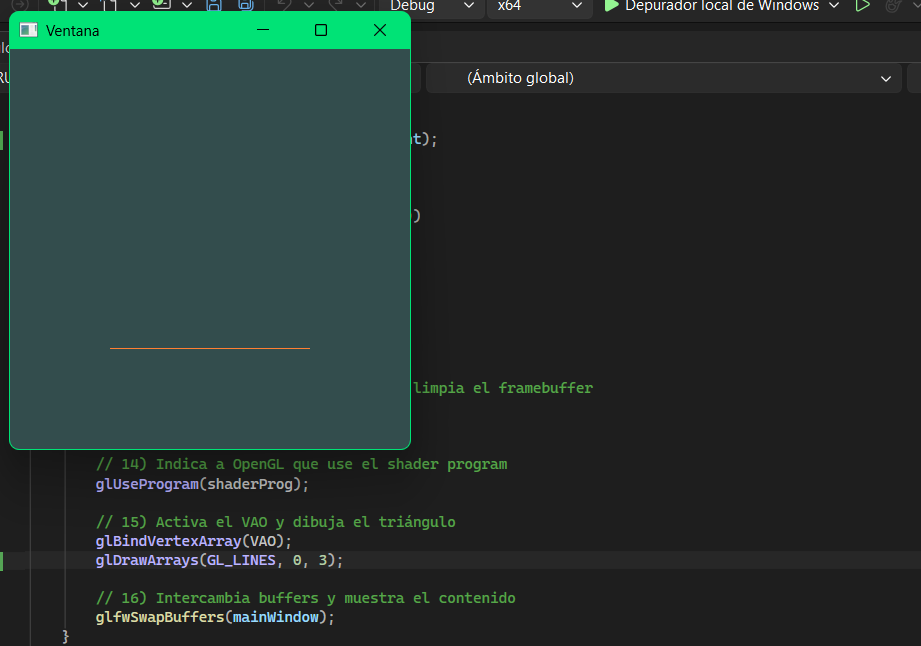
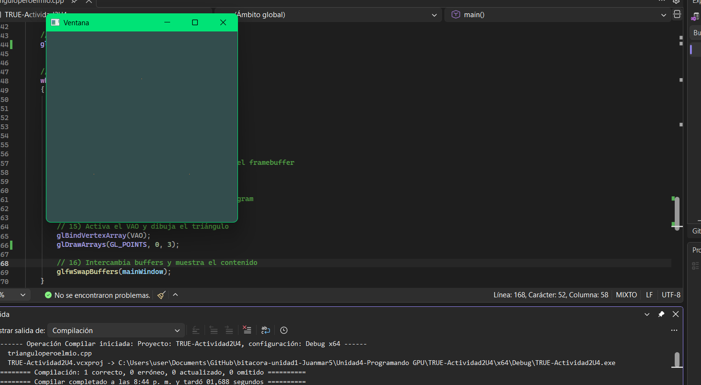
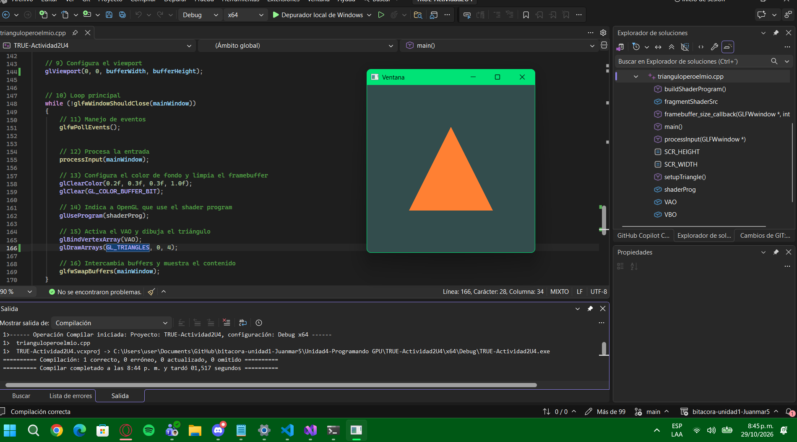
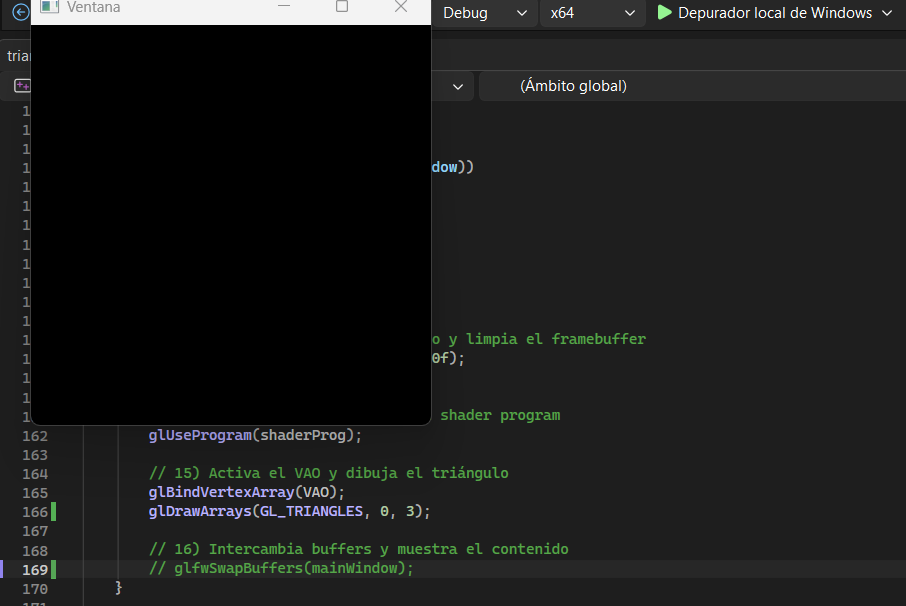

# **Actividad 04**

# **Análisis del ejemplo del triángulo simple parte 2**

### Diferencia entre CPU y GPU - Video Mona Lisa
- La CPU tiene pocos núcleos, bastante potentes y flexibles, hace tareas complejas una tras otra (o pocas a la vez), como la lógica del programa, el sistema operativo o la IA de algún juego.
- La GPU tiene miles de núcleos pequeños y simples. Hace la misma operación sobre muchísimos datos al mismo tiempo.

#### ¿Por qué sirve para gráficos?
Porque pintar una imagen es calcular el color de millones de píxeles, y cada uno se calcula de forma independiente con la misma fórmula. Eso es justo lo que la GPU hace bien: muchas cosas iguales al mismo tiempo.

#### Análisis del video
La CPU es un cañón de paintball que dispara un tiro preciso a la vez, por eso se demora pintando una carita feliz. La GPU es un cañón gigante con muchísimos tubos que dispara miles de bolas de pintura al mismo tiempo y pinta la Mona Lisa completa de un solo golpe.

### Preguntas del video

1. Los tres pasos clave son:
   - Vertex shading: toma los objetos en 3D y calcula dónde caen en la pantalla 2D según la cámara. Lo hace moviendo cada vértice con matrices (del modelo al mundo, del mundo a la cámara y de la cámara a la pantalla). Aparte guarda la profundidad (Z) de cada vértice para usarla después
   - Rasterización: con los 3 vértices de cada triángulo mira qué píxeles de la pantalla quedan cubiertos por él
   - Fragment shading: pinta esos píxeles con el color correcto teniendo en cuenta la luz, sombras y brillos pa que se vea real
2. Antes el pipeline era fijo, los pasos ya venían hechos y uno solo podía cambiar algunas opciones. Ahora es programable, o sea que uno mismo escribe los programas (shaders) que corren en la GPU.
3. La rasterización es tomar cada triángulo ya ubicado en la pantalla y ver qué píxeles quedan dentro de él (en una pantalla 4K son como 8.3 millones de píxeles). Pasa de algo "matemático" (3 puntos) a algo que la pantalla entiende (píxeles). Se repite con todos los triángulos, en el ejemplo del video eran 3.5 millones
4. En el video los fragmentos son el grupo de píxeles que salen del mismo triángulo y comparten color o textura. No es lo mismo que un píxel porque un fragmento todavía no es definitivo: puede que otro triángulo lo tape y nunca se vea. Además varios fragmentos de diferentes triángulos pueden caer en el mismo píxel, y solo uno gana
5. El Z-buffer resuelve el problema de visibilidad, o sea saber qué está adelante y qué está atrás (como el tren tapando la estación). Guarda la profundidad de cada píxel. El depth test es la comparación: si el triángulo nuevo tiene Z más bajo (está más cerca) se pinta y se actualiza el Z-buffer, si tiene Z más alto (está más lejos) se bota
6. El aliasing pasa porque la pantalla está hecha de cuadritos: si un triángulo pasa en diagonal por el centro de un píxel, el píxel se pinta completo y los bordes salen como escalera (serrucho). El anti-aliasing lo suaviza. Por ejemplo el SSAA pone 16 puntos de muestra dentro de cada píxel y según cuántos cubra el triángulo, le da un tono parcial de su color, así los bordes se ven difuminados
7. El fragment shader es donde se hace la iluminación: si una superficie mira directo a la luz se pinta más clara, y si mira de lado o al revés, más oscura. Se calcula con el ángulo entre la luz y la normal (hacia dónde mira el triángulo), y se le suma una luz ambiente para que nada quede totalmente negro. No es obligatorio usar iluminación: el shader del triángulo pinta naranja fijo sin luz. Pero sin iluminación todo se ve plano y falso, como el tren negro del video que sin sombreado se veía horrible. Con luz se ve con volumen, pero cuesta más cálculos (Tbh lo entiendo mejor porque así lo hace la opción en Blender)
8. Con varias luces, el cálculo de iluminación se repite una vez por cada luz y se suman los resultados. Eso es mucho más trabajo para la GPU, por eso los juegos limitan la cantidad de luces y hasta el alcance de cada una, pa que los triángulos ignoren las luces lejanas

### Resúmen

1. Para dibujar un triángulo se necesita:
   - Definir los 3 vértices (en coordenadas de -1 a 1)
   - Crear un VBO y mandarle esos datos a la GPU
   - Crear un VAO que le dice a OpenGL cómo leer esos datos
   - Tener un shader program (vertex + fragment)
   - En el loop: activar el shader, activar el VAO y llamar glDrawArrays

2. Para usar un shader se necesita:
   - Escribir el código del shader en GLSL
   - Crearlo, compilarlo y revisar si tiene errores
   - Crear un programa, pegarle los shaders y linkearlo
   - Borrar los shaders sueltos (ya quedan dentro del programa)
   - Activarlo con glUseProgram antes de dibujar

### Experimento de los 3 shaders

**Predicción:** van a salir 3 triángulos en lugares distintos

**Resultado:**
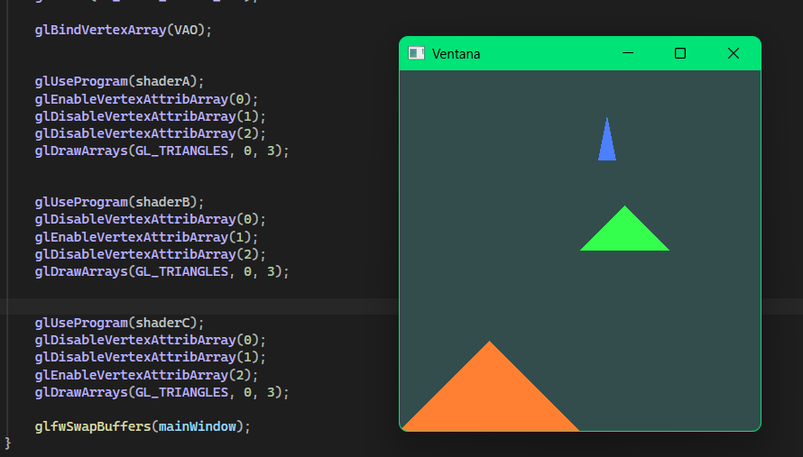

**Conclusión:** un mismo VBO puede guardar varios datos por vértice, y cada shader solo usa el que le toca según su location. Le cambié el color a cada shader para distinguirlos.

# **Actividad 05**

# **Triángulo interactivo**

### ¿Qué es un uniform?
Es una variable que se manda desde C++ al shader. Es igual para todos los vértices y fragmentos del mismo dibujo (no cambia por vértice como los atributos). Sirve pa pasarle cosas como el color o la posición del mouse.

### Cambios que hice
- Al vertex shader le agregué un uniform `offset` que le suma a la posición del triángulo pa moverlo
- Al fragment shader le agregué un uniform `ourColor` pa cambiarle el color
- Antes del loop busqué dónde quedaron los uniforms con glGetUniformLocation
- Dentro del loop leo el mouse, lo normalizo y mando el color y la posición con glUniform

### Triángulo funcionando

https://youtu.be/dojBdkbjoA8

El triángulo sigue al mouse. El color cambia según dónde esté: la x controla el rojo y la y el verde. Arriba a la izquierda queda casi negro, arriba a la derecha rojo, abajo a la izquierda verde y abajo a la derecha amarillo.

### Normalización del mouse
GLFW me da la posición del mouse en píxeles de la ventana: va de 0 a 400, el (0,0) está arriba a la izquierda y la y crece hacia abajo.
Normalizar es dividir por el tamaño de la ventana pa que quede entre 0 y 1, sin importar el tamaño:
- x = xpos / 400
- y = ypos / 400
Después se limita (si es menor a 0 queda en 0, si es mayor a 1 queda en 1) porque el mouse se puede salir de la ventana y daría números raros.
Ese 0 a 1 sirve directo pa el color, porque en OpenGL los colores también van de 0 a 1.

### Normalización a NDC
OpenGL no usa píxeles, usa NDC: va de -1 a 1, el (0,0) está en el centro y la y crece hacia arriba.
Entonces hay que pasar del 0 a 1 al -1 a 1:
- En x: x*2 - 1 → si x = 0 queda en -1 (izquierda), si x = 1 queda en 1 (derecha)
- En y: 1 - y*2 → aquí se voltea, porque el mouse cuenta hacia abajo y OpenGL hacia arriba. Si y = 0 (arriba) queda en 1, si y = 1 (abajo) queda en -1
Así el offset queda en el mismo sistema que los vértices del triángulo y se mueve justo donde está el mouse.

# **Actividad 06**

# **Aplica lo aprendido en esta unidad**

### 1. Cambios en el código C++
Partí de la Actividad 05, el triángulo sigue al mouse, pero le quité el uniform del color (ourColor) y le puse uno de tiempo.
- Antes del loop busco dónde quedó el uniform `time` con glGetUniformLocation
- Dentro del loop, en cada frame, leo el tiempo con glfwGetTime() (los segundos desde que arrancó GLFW) y se lo mando al shader con glUniform1f
- Se usa uniform porque el tiempo es el mismo pa todos los vértices y fragmentos del dibujo

### 2. Fragment shader modificado
    #version 460 core
    out vec4 FragColor;
    uniform float time;
    void main() {
        float r = (sin(time) + 1.0) / 2.0;
        float g = (sin(time + 2.094) + 1.0) / 2.0;
        float b = (sin(time + 4.188) + 1.0) / 2.0;
        FragColor = vec4(r, g, b, 1.0);
    }

### 3. Cómo usé el tiempo
- sin(time) sube y baja suave entre -1 y 1 todo el tiempo, se repite cada 6.28 segundos más o menos
- Pero los colores en OpenGL van de 0 a 1, entonces le sumo 1 (queda de 0 a 2) y lo divido entre 2 (queda de 0 a 1)
- Si usara el mismo valor pa los 3 canales el triángulo solo pasaría de negro a blanco. Por eso a cada canal le sumé un desfase (2.094 y 4.188 son un tercio y dos tercios de la vuelta), así cuando el rojo está al máximo los otros van bajando o subiendo
- Resultado: el triángulo pasa suave por rojo, amarillo, verde, cian, azul, morado y vuelve a empezar, como un arcoíris que gira

### 4. Resultado
https://youtu.be/c_SjnQwaHsQ

### 5. Reflexión: otros efectos con el tiempo
- Posición: sumarle sin(time) al offset pa que el triángulo flote de lado a lado o suba y baje solo
- Tamaño: multiplicar aPos por algo como (sin(time) + 1.5) / 2 pa que el triángulo crezca y se encoja, como si latiera
- Rotación: usar cos(time) y sin(time) pa girar los vértices alrededor del centro, así el triángulo daría vueltas solo
- Velocidad: multiplicar el tiempo, por ejemplo sin(time * 3.0), pa que el cambio sea más rápido